# witchbox1 manual

The eighty Witchbox toys of Playbox, on the M-VAVE FM-1. A toy is a small generative sequencer with
four knobs and a four-digit seed: the same seed and knobs play the same notes every time, on the FM-1
as on the Pico. Up to eight toys play together as a band, on one clock and one run of chords, and a
Tape or a Clock arranges which of them play in which bars.

Installing custom firmware is at your own risk. Read "Before you install" first.

## Before you install

- witchbox1 replaces the FM-1's firmware. Nothing of M-VAVE's stays: not the FM synthesizer, not
  its presets, not its sequences. Save anything you want to keep first.
- Going back: the web installer's "Return to official V15" writes M-VAVE's V15 firmware, and M-VAVE's
  own M-UPGRADE tool works too. witchbox1's saved toys and bands are lost on the way back.
- If witchbox1 crashes twice while starting it comes up in a safe mode (no sound, USB on) from which
  you can reinstall, or go back to V15. PLAY in safe mode tries witchbox1 again.
- If the screen stays blank and nothing reaches the FM-1 by USB, see "Rescue" at the end.

## The panel

```
  MASTER   SELECT      ALGORITHM  PRESETS         KNOB 1  KNOB 2  KNOB 3  KNOB 4
  volume   the page    the toy    the seed        the toy's four knobs (or a layer's)

  FX   SEL   ENV   LFO          EDIT  GLO   HOME  SAVE        ARP  SEQ   PLAY  REC   OCT-  OCT+
  hold hold  hold  hold         hold  hold  tap   hold        tap  tap   tap   tap   tap   tap
```

Every toy has exactly four knobs, and KNOB 1–4 are those four, always. The bottom of the screen
names them. Hold a button and the four knobs become that button's four instead; the bottom of the
screen says which.

### Encoders

| Encoder | Does |
| --- | --- |
| MASTER | the volume (the pot) |
| SELECT | the pages: Toy, Band, Tape, Clock, Saves |
| ALGORITHM | the toy in this seat, along the shelf (the seed stays) |
| PRESETS | the seed, one at a time; spin it for tens and hundreds |
| KNOB 1–4 | the toy's knobs, or the held button's layer |

### Buttons

| Button | Tap | Held |
| --- | --- | --- |
| PLAY | the band plays / stops. Play always starts every toy from the top of its seed | |
| REC | Random: a new seed for this toy, and the knobs that go with it | a random band of eight (drums, bass, chords, lead, voice, texture, a second lead and chords), fresh seeds; on the Tape or Clock page, a random arrangement instead |
| OCT− / OCT+ | the seat on screen (1 to 8); on the shelf, its page | |
| HOME | the shelf: twenty toys on the keys, OCT−/OCT+ for the other pages (Witch I to IV) | knobs: lights, volume |
| SEL | the next dark scale (Playbox's SCALE button) | |
| ARP | mute this seat | |
| SEQ | the arrangement: Band (everyone plays), Tape, Clock, round again; the page follows | |
| SAVE | save everything now | + a white key: save this toy there (1–16); + a black key: save the whole band there (1–4) |
| GLO | help pages (ALGORITHM turns them) | knobs: Scale, Chords, Tempo, Rate; white keys pick the chords, black keys the scale |
| EDIT | | knobs: the four digits of the seed; white keys 1–10 type a digit (0 is key 1) |
| FX | | knobs: Drive, Crush, Echo, Feedback |
| ENV | | knobs: the mixer, seats 1–4 or 5–8 (whichever half the seat on screen is in); + white key 9–16: solo that seat while held |
| LFO | | knobs: Drift, a slow wobble on each of the toy's knobs, 0 to 10 |

### The 27 keys are pads

The sixteen white keys are numbered 1 to 16 from the lowest F; the eleven black keys 1 to 11.

| Keys | Do |
| --- | --- |
| white 1–7 | held: steer the chord root to that scale step (every toy follows) |
| white 8 | everyone back in (all mutes off) |
| white 9–16 | mute seat 1–8 (the key lights while the seat plays); with ENV held, solo it instead |
| black 1 | dice: a new seed (as REC) |
| black 2 | the seed before the last dice |
| black 3 | half time, on and off |
| black 4 | double time, on and off |
| black 5 | held: freeze (the clock stops) |
| black 6 | held: brake (the clock winds down); let go and it snaps back |
| black 7 | held: filter (every seat goes dull) |
| black 8 | held: crush |
| black 9 | held: drive |
| black 10 | held: echo throw |
| black 11 | calm: speed, solo, drift and the effects back to normal |

Two things to know about the pads. A seated Screw conductor sets the clock's speed every frame, so
with Screw in the band the half, double, freeze and brake keys do nothing until it is unseated; the
same goes for calm. Steering the chord root (white keys 1–7) holds every toy to that root, the
chord "that is coming" included, so Swell, Wet Piano, Riser and Tape Loop lean on it too.

On the Tape page the sixteen white keys are the sixteen bars in view of this seat's lane: a key
toggles a bar.

With HOME's shelf open, white keys 1–16 and black keys 1–4 are the twenty toys of that page.
On the Saves page, white keys load a saved toy into this seat and black keys 1–4 load a saved band.
With SAVE held, the same keys save. With GLO held, white keys 1–16 pick Random and the fifteen
progressions, black keys 1–9 the scale. With EDIT held, white keys type the seed.

### The screen

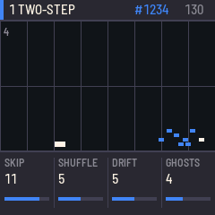 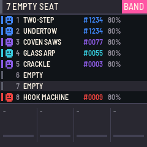 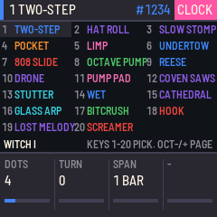

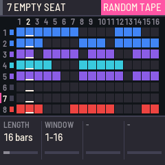 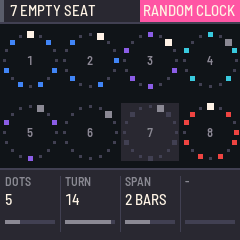 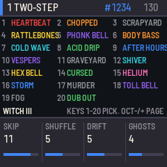 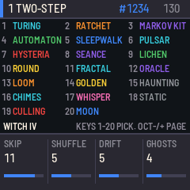

- **The top line**: the seat number and its toy, the seed, the tempo. A message appears at the right
  for a moment when something happens (NEW SEED, SAVED, SCALE ...).
- **The Toy page**: what this seat has played in the last six seconds, scrolling left: a dot per
  note, higher for higher notes, drums low down. The bar number is at the top left, the step marker
  along the bottom. MUTED when it is.
- **The Band page**: the eight seats, each with its toy, seed, volume and a trail of dots for its
  notes, and the singers: which seat the chords, the lead and the kick are coming from. The seat
  on screen is highlighted. The top line shows the arrangement (BAND, TAPE or CLOCK) and the bar.
- **The Tape page**: a lane per seat, a cell per bar: the seat plays in the bars that are on.
  KNOB 1 is the tape's length (4 to 64 bars), KNOB 2 the sixteen-bar window in view; the white
  keys toggle this seat's bars; REC held rolls a random tape.
- **The Clock page**: each seat plays a Euclidean pattern of bars: KNOB 1 how many of sixteen dots
  (bars) it plays, KNOB 2 turns the pattern, KNOB 3 the span of a dot (1, 2 or 4 bars). Dots are
  spread as evenly as they can be, so eight seats on different counts make a slowly turning song.
- **The Saves page**: the sixteen toy slots and the four band slots (a band slot keeps its
  arrangement too).
- **The bottom**: the four knobs, their values and a bar each. While a button is held, its layer's
  four, in pink, with the layer's name.

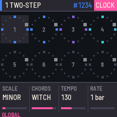 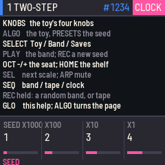 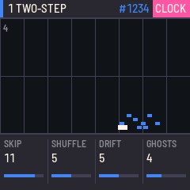 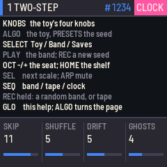

### Lights

PLAY is green while the band plays, SEQ while a Tape or Clock is arranging. The keys of seats that
hold a toy (white 9–16) are lit; a key
flashes when its seat sounds a note, and the lower white keys flash with the notes themselves.
Hold HOME and turn KNOB 1 for the lights: on, keys only, or off.

## The toys

Four pages of twenty: Witch I and II are pages three and four of Playbox's shelf (Witchbox III and
IV there); Witch III is the twenty toys Playbox v0.12 added, made again here from their descriptions;
Witch IV is twenty of witchbox1's own, each built on a classic generative method.

| | Drums | Bass | Chords | Lead | Voices and textures | Conductors |
| --- | --- | --- | --- | --- | --- | --- |
| Witch I | Two-Step, Hat Roll, Slow Stomp, Pocket Change, Limp | Undertow, 808 Slide, Octave Pump, Reese, Drone | Pump Pad, Coven Saws, Stutter Gate, Wet Piano, Cathedral | Glass Arp, Bitcrush Arp, Hook Machine, Lost Melody, Screamer | | |
| Witch II | Four Floor, Snare Rush, Broken Clock, Fog Toms | | Rave Stab, Swell, Tape Loop | Music Box, Siren, Shadow | Riser, Crackle, Night Bus, Ghost Voice, Stutter Chop, Screwed Voice, Breath Stack | Blackout, Screw, Arc |
| Witch III | Heartbeat, Chopped Break, Scrapyard, Rattlebones, Phonk Bell | Body Bass, Cold Wave, Acid Drip | After Hours, Vespers, Graveyard Guitar, Shiver | Hex Bell, Cursed Cartridge, Helium | Storm, Murder, Toll Bell | Fog, Dub Out |
| Witch IV | Turing Drums, Ratchet, Markov Kit, Automaton | Sleepwalk, Pulsar, Hysteria | Seance, Lichen, Round | Fractal, Oracle, Loom, Golden, Haunting | Chimes, Whisper, Static | Culling, Moon |

Each toy's four knobs are its own (the screen names them). For Witch I and II, Playbox's
descriptions apply unchanged, and the notes are Playbox's note for note. Witch III:

- **Heartbeat**: only a kick drum, beating like a heart; now and then it flutters or misses, and
  skips the end of a phrase. **Chopped Break**: a drum break cut into eight slices and put back in
  the wrong order. **Scrapyard**: machines for drums — clanks of tin, glass and wood, each on a cycle
  of its own. **Rattlebones**: dry wooden notes in short figures that turn against the beat.
  **Phonk Bell**: a slow, heavy beat with a tune on a cowbell over it.
- **Body Bass**: a plucked bass that carries a tune, walking between the notes of the chord.
  **Cold Wave**: a hard, metallic bass repeating one rigid pattern, with octave jumps. **Acid
  Drip**: a squelching bass line in quick notes that bend into each other.
- **After Hours**: slow electric piano chords with extra notes on top, played a little late.
  **Vespers**: a low choir chanting long, slow notes that barely move. **Graveyard Guitar**: a
  guitar picking the chord one string at a time and letting it ring. **Shiver**: dark strings bowed
  fast and nervously, swelling up and dying back.
- **Hex Bell**: a short tune on a bright bell, then a long silence, then the tune again. **Cursed
  Cartridge**: an old video game tune that sticks, repeats and leaps where it should not.
  **Helium**: a squeaky, pitched-up voice singing a quick phrase and its answer.
- **Storm**: wind and rain that never stop, and thunder now and then. **Murder**: crows calling from
  a wire, near and far, with a flurry of wings. **Toll Bell**: one deep bell, struck every few bars
  and left to ring.
- The conductors make no sound. **Blackout** cuts the band every so many bars; **Screw** slows and
  lowers everything and stops the tape dead now and then; **Arc** shapes a song (intro, build, drop,
  break, drop, outro) by thinning each seat's notes; **Fog** makes the whole band duller and
  brighter, like fog rolling in and lifting; **Dub Out** throws one part into the echo at the end of
  each phrase.

Witch IV, and the method behind each:

- **Turing Drums**: a shift register (the Turing machine sequencer): sixteen bits go round and three
  drums read them at different taps; Change is the chance a bit flips as it passes, from locked to
  new every bar. **Ratchet**: a plain beat whose hits ratchet into two, three or four quick strikes.
  **Markov Kit**: each hit draws the next from a table of chances the seed dealt (a Markov chain):
  habits, no fixed bar. **Automaton**: a bar of sixteen cells grows the next bar by one of
  Wolfram's rules (30, 90, 110, 150); live cells are hits.
- **Sleepwalk**: a random walk on the chord's notes, with momentum and a pull home. **Pulsar**: the
  root on a Euclidean rhythm (so many hits spread as evenly as they can over so many steps, turned
  round). **Hysteria**: the logistic map picks every note; Chaos takes it from one steady note
  through period doubling to chaos.
- **Seance**: a glass pad whose voicing (close, open, wide, cluster, bare fifth) is chosen each bar
  by a chain of chances. **Lichen**: an L-system rewrites a string of long and short notes
  (Fibonacci, Thue–Morse or triplet rules) into the rhythm of the organ chords. **Round**: a harp
  line played as a canon, each voice entering a little after the last.
- **Fractal**: a motif applied to itself, level by level (the motif, played from each of its own
  notes). **Oracle**: a Markov melody; Entropy turns one fixed tune into anything goes. **Loom**: a
  loop of notes on a shift register, rewoven a note at a time. **Golden**: the Fibonacci word for the
  rhythm, Fibonacci numbers for the notes. **Haunting**: every whistled note comes back lower a few
  steps later, and that one too: a dying chain.
- **Chimes**: gusts set off clusters of bell notes that die away. **Whisper**: breathy voice
  fragments in bursts (a Poisson burst process). **Static**: crackle and rumble driven by 1/f
  noise (Voss's dice, each rerolled half as often as the last).
- **Culling** (conductor): every phrase draws lots and cuts seats for the phrase; the drums (and
  bass) can be spared, and at least so many always stay. **Moon** (conductor): moves the whole band
  to the next dark scale each phase, sometimes with new chords, and comes home at the end of its
  cycle.

Witch III and IV's seeds are their own: the same seed plays the same notes on every witchbox1, but
there is no Pico to compare them with.

## Seeds

A toy rolls its own dice from its seed, 0000 to 9999, and Play starts it again from the top: the same
seed and knobs give the same tune every time. witchbox1's dice are Playbox's, bit for bit, and every
Witch I and II toy was checked note for note against Playbox's own Python (README: what is verified), so a seed from a
Pico running that Playbox plays the same notes here (the clock runs in the same 5 ms slices; the
band's chords change once a bar, as a toy's do alone, at Rate "1 bar"). REC rolls a new seed and takes the knobs
from it, as Playbox's RANDOM did; black key 2 brings the seed before it back.

## Saving

The band — its eight seats, their seeds and knobs, the mixer, the scale and chords, and its Tape or
Clock — is saved by itself a few seconds after a change while it is stopped, and SAVE saves it at
once. There are sixteen slots for toys and four for whole bands (hold SAVE, press a key; the Saves
page loads them). Saving pauses the sound for a moment while the flash is written.

## Rescue

| What you see | What to do |
| --- | --- |
| witchbox1's safe mode | reinstall from the web installer, or return to V15; PLAY tries witchbox1 again |
| "UPDATE MODE" | hold OCT− and OCT+ for five seconds at power-on: the chip's own update mode; M-VAVE's M-UPGRADE tool also works |
| a blank screen, and the installer cannot find the FM-1 | on a Mac: `sh tools/fm1_rescue.sh`. Otherwise recovery needs a small hardware adapter, [FM-1-transporter](https://github.com/kurogedelic/FM-1-transporter) |
